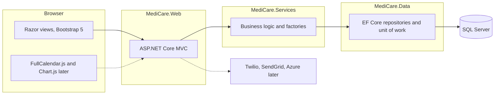

# MediCare

Clinic management and appointment system. DEPI graduation project for a six-person team. Most of the team is new to .NET, so this repository starts as a small skeleton: a buildable ASP.NET Core MVC app, empty class libraries, and placeholder folders. Entities, repositories, and ASP.NET Identity are left for Jira tasks.

## Stack

- ASP.NET Core MVC on .NET 8 (LTS)
- Entity Framework Core with SQL Server
- ASP.NET Identity roles planned: Patient, Doctor, Admin
- Later: SignalR, Twilio, SendGrid, FullCalendar.js, Chart.js, Azure
- UI: Bootstrap 5 (included with the MVC template)

## Architecture

N-tier. The web project depends on services, and services depend on data. Repository, Unit of Work, and Factory types are not written yet; the folders are ready and dependencies are injected from `Program.cs` when those types exist.



Solid arrows are the project references in this skeleton. Dashed arrows are planned and not implemented.

## Folder structure

```text
MediCare.sln
src/
  MediCare.Web/          MVC site (controllers, views, wwwroot)
    ViewModels/          view models for new screens
    Hubs/                SignalR placeholder
  MediCare.Services/     business logic
    Interfaces/
    Implementations/
    Factories/
  MediCare.Data/         EF Core, repositories, unit of work
    Entities/
    Repositories/
    Interfaces/
    UnitOfWork/
    Configurations/
    Migrations/
tests/
  MediCare.Tests/        xUnit
docs/                    architecture, ERD, user manual, setup guide
.github/
  workflows/ci.yml
  pull_request_template.md
```

Project references: `MediCare.Web` → `MediCare.Services` → `MediCare.Data`. The test project references all three. `MediCare.Data` already references EF Core SQL Server, EF Core Tools, and ASP.NET Identity Entity Framework Core 8.0.31. No `DbContext` or Identity types are included.

## Run locally

Install the [.NET 8 SDK](https://dotnet.microsoft.com/download/dotnet/8.0). `global.json` asks for the 8.0 feature band.

```bash
dotnet restore MediCare.sln
dotnet build MediCare.sln
dotnet test MediCare.sln
dotnet run --project src/MediCare.Web --launch-profile http
```

Open `http://localhost:5067`. The HTTPS profile is in `src/MediCare.Web/Properties/launchSettings.json`. SQL Server is not required yet. Add the connection string with [user secrets](https://learn.microsoft.com/aspnet/core/security/app-secrets) when the database task starts, not in `appsettings.json`.

## Team

Mahmoud, Ahmed, Ehab, Peter, Salem, Hady.

How we branch and open pull requests is in [CONTRIBUTING.md](CONTRIBUTING.md). Documents go in [docs/](docs/README.md).
